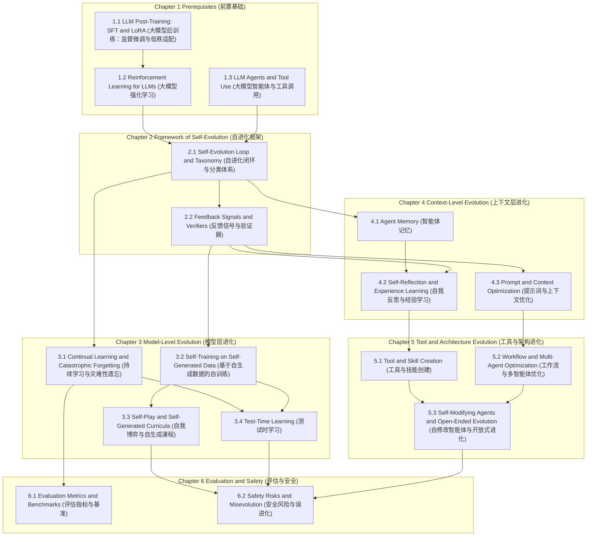

# Post-Deployment Self-Evolution (部署后自进化)

## Dependency Graph (依赖图)

## Chapter 1 Prerequisites (前置基础)

### 1.1 LLM Post-Training: SFT and LoRA (大模型后训练：监督微调与低秩适配)

### 1.2 Reinforcement Learning for LLMs (大模型强化学习)

### 1.3 LLM Agents and Tool Use (大模型智能体与工具调用)

## Chapter 2 Framework of Self-Evolution (自进化框架)

### 2.1 Self-Evolution Loop and Taxonomy (自进化闭环与分类体系)

### 2.2 Feedback Signals and Verifiers (反馈信号与验证器)

## Chapter 3 Model-Level Evolution (模型层进化)

### 3.1 Continual Learning and Catastrophic Forgetting (持续学习与灾难性遗忘)

### 3.2 Self-Training on Self-Generated Data (基于自生成数据的自训练)

### 3.3 Self-Play and Self-Generated Curricula (自我博弈与自生成课程)

### 3.4 Test-Time Learning (测试时学习)

## Chapter 4 Context-Level Evolution (上下文层进化)

### 4.1 Agent Memory (智能体记忆)

### 4.2 Self-Reflection and Experience Learning (自我反思与经验学习)

### 4.3 Prompt and Context Optimization (提示词与上下文优化)

## Chapter 5 Tool and Architecture Evolution (工具与架构进化)

### 5.1 Tool and Skill Creation (工具与技能创建)

### 5.2 Workflow and Multi-Agent Optimization (工作流与多智能体优化)

### 5.3 Self-Modifying Agents and Open-Ended Evolution (自修改智能体与开放式进化)

## Chapter 6 Evaluation and Safety (评估与安全)

### 6.1 Evaluation Metrics and Benchmarks (评估指标与基准)

### 6.2 Safety Risks and Misevolution (安全风险与误进化)