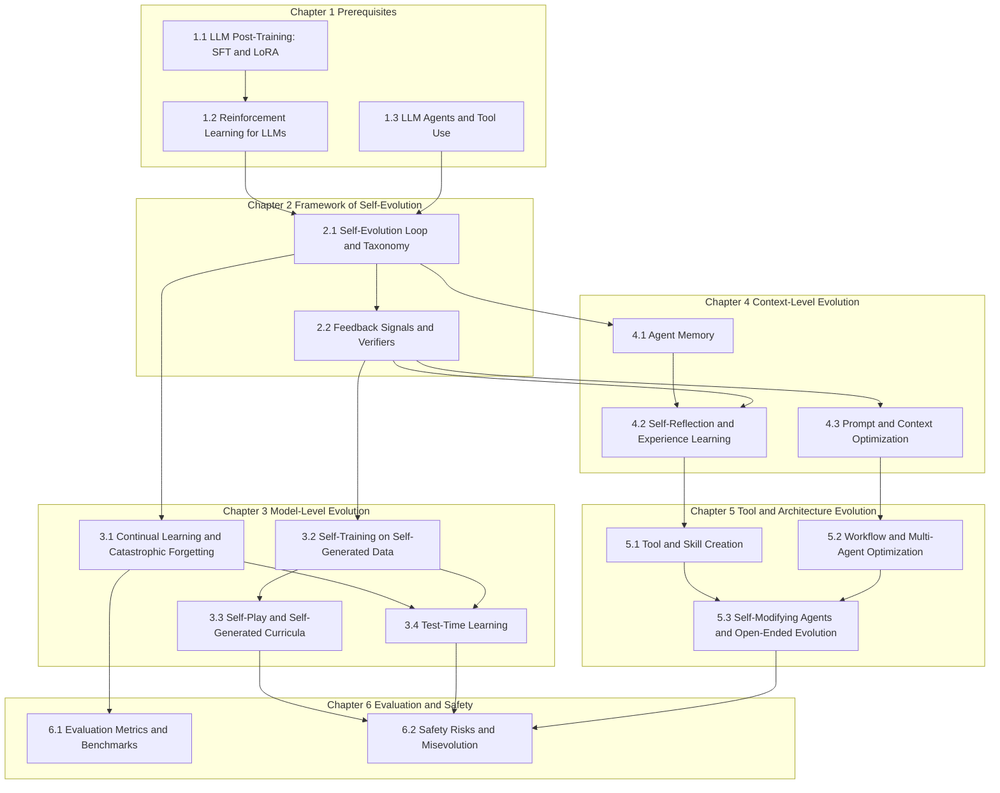

# Post-Deployment Self-Evolution

## Dependency Graph

## Chapter 1 Prerequisites

### 1.1 LLM Post-Training: SFT and LoRA

### 1.2 Reinforcement Learning for LLMs

### 1.3 LLM Agents and Tool Use

## Chapter 2 Framework of Self-Evolution

### 2.1 Self-Evolution Loop and Taxonomy

### 2.2 Feedback Signals and Verifiers

## Chapter 3 Model-Level Evolution

### 3.1 Continual Learning and Catastrophic Forgetting

### 3.2 Self-Training on Self-Generated Data

### 3.3 Self-Play and Self-Generated Curricula

### 3.4 Test-Time Learning

## Chapter 4 Context-Level Evolution

### 4.1 Agent Memory

### 4.2 Self-Reflection and Experience Learning

### 4.3 Prompt and Context Optimization

## Chapter 5 Tool and Architecture Evolution

### 5.1 Tool and Skill Creation

### 5.2 Workflow and Multi-Agent Optimization

### 5.3 Self-Modifying Agents and Open-Ended Evolution

## Chapter 6 Evaluation and Safety

### 6.1 Evaluation Metrics and Benchmarks

### 6.2 Safety Risks and Misevolution